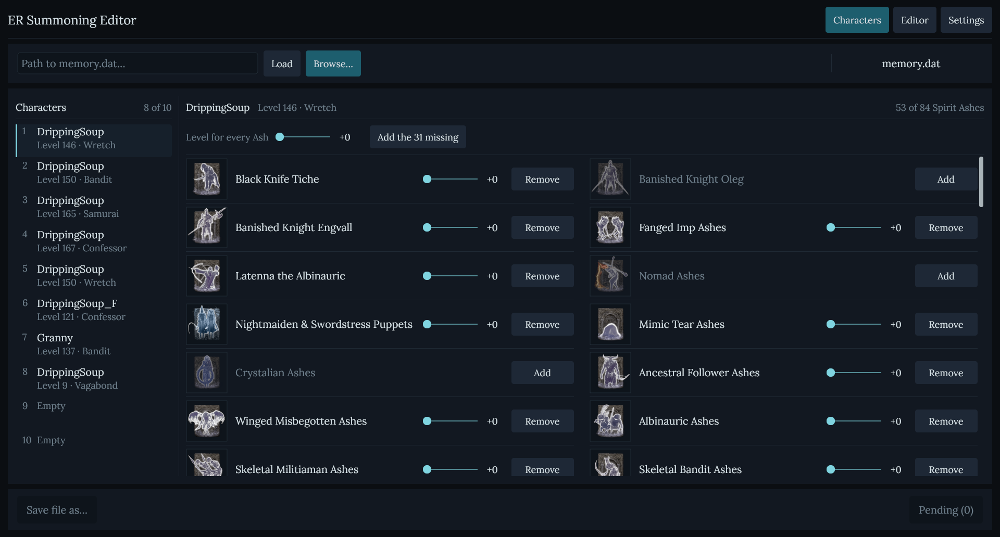
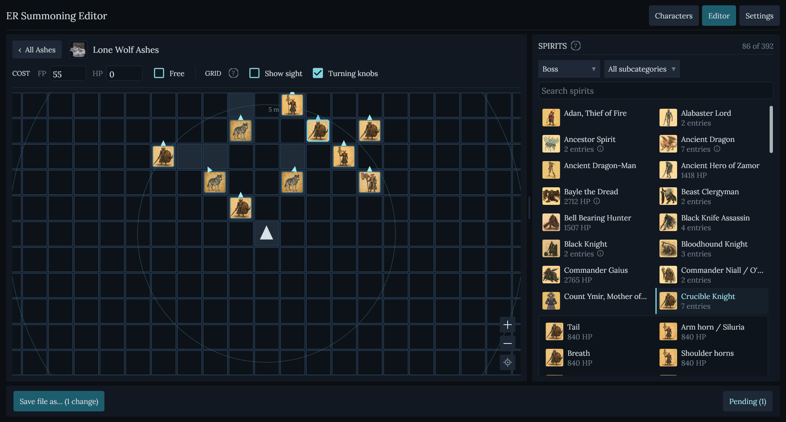
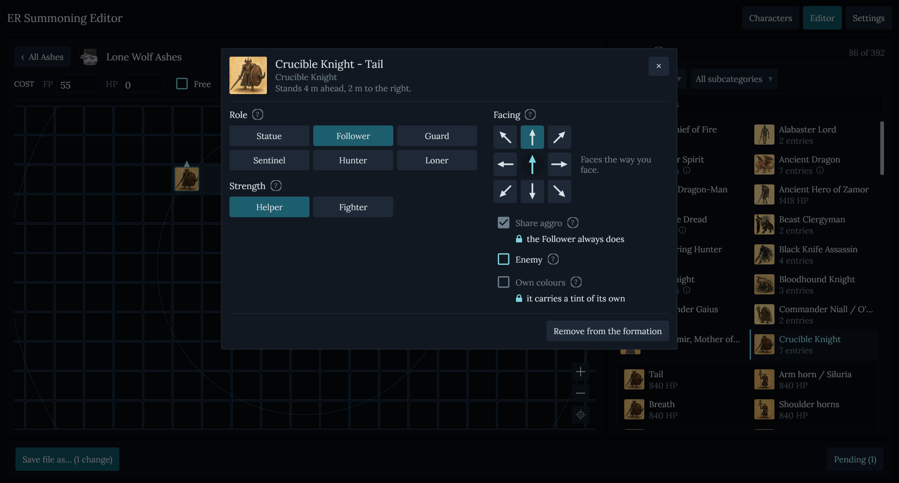
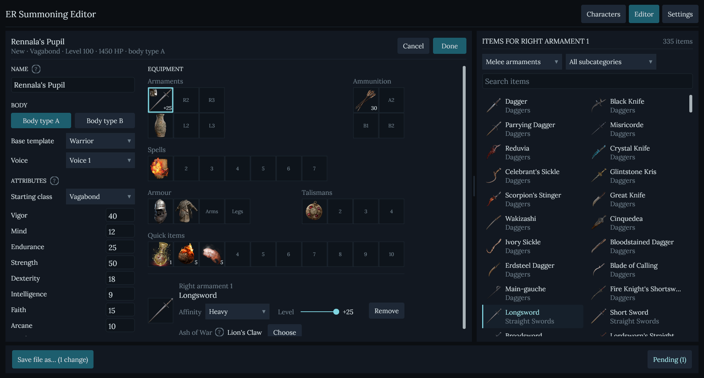
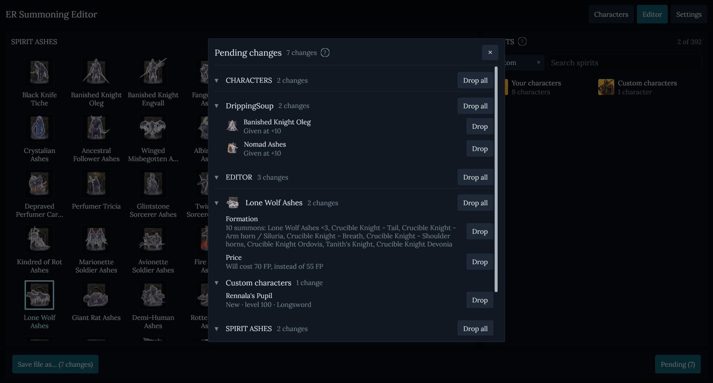
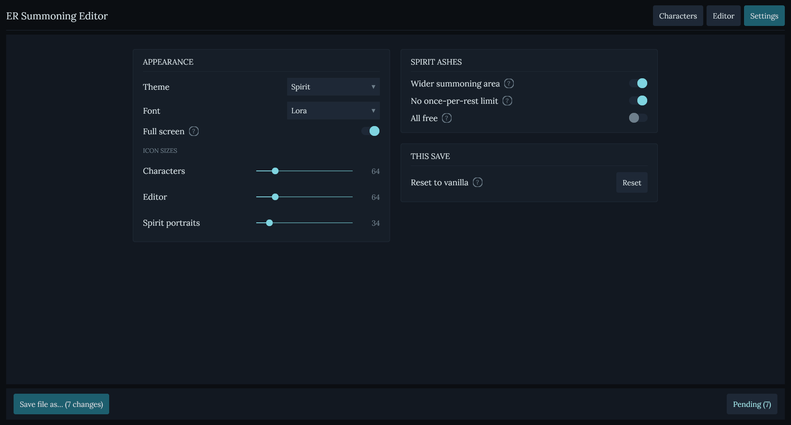

# ER Summoning Editor

ER Summoning Editor is a free desktop save editor for **Elden Ring's Spirit
Ashes on PS4**. Fill any Ash with up to ten creatures the game holds - bosses,
enemies, NPCs, wildlife, the game's own spirits, even your own characters -
place each one around you, and choose how it fights: at your side, on its own,
or against you.

The editor is available for **Windows and Linux**, together with a
command-line tool that has the same engine.

**[Download the latest release →](../../releases/latest)**

## Read this first

- **Always keep an untouched backup.** Never experiment on your only save.
- **The input must be a decrypted PS4 `memory.dat`.** PlayStation's outer save
  encryption and signing are separate from this editor; use an appropriate
  third-party tool to decrypt the save before editing and to prepare it for
  the console afterward. PC saves (`ER0000.sl2`) are not supported.
- **Always edit a save from the game's newest version.** The game settings
  this editor changes (the regulation) live inside the save, and whenever you
  go online with a save whose regulation is older than the game's newest, the
  game replaces the whole regulation with the newest one, and every edit is
  lost. So after each game update, load your character once while online,
  then back the save up and edit that copy. A save from a game version the
  editor does not know yet is refused.
- Changes are staged and written to a **new file**. The selected input file is
  never overwritten, and the output is reopened and verified before the
  editor reports success.
- **No creature in the world is changed.** A summon is a copy of the
  creature, made for your Ash; the enemy you meet in the world still fights
  and drops what it did.
- The editor is made for **solo play**. The game does not let Spirit Ashes be
  used in multiplayer, and the editor writes no multiplayer setting.

### Important: applying changes while playing online

When Elden Ring connects online, the first load of a character runs the
server's copy of the game's settings, not your save's. To make your Ashes
appear as you edited them:

1. Start Elden Ring and load the character.
2. Exit that character back to the title menu **without closing the game**.
3. Load the character again in the same game session.

The changes appear after the second character load. Do not close Elden Ring
between steps 2 and 3.

## Quick start

1. Download the zip for your system, extract it, and run
   `ERSummoningEditor.exe` on Windows or `ERSummoningEditor` on Linux.
2. Make a backup, then decrypt the PS4 save with your usual save tool.
3. Paste or browse to the decrypted `memory.dat` and select **Load**.
4. Make your changes. **Pending (N)** shows everything waiting to be written;
   review or drop changes there at any time.
5. Select **Save file as...** and choose a new destination.
6. Prepare the output for your console with the same external save workflow.
   If you play online, follow the two-load procedure above.

On Linux, file dialogs require `zenity`, `matedialog`, or `qarma`; install one
with your distribution's package manager if Browse or Save does not open.
Under WSL the window is scaled by 1.25, to match Windows' usual 125%; set
`ER_EDITOR_UI_SCALE` (0.5 to 3) to choose another scale.

## Features

### Characters

Choose one of the save's characters and the Spirit Ashes it holds.

<p align="center">
  
</p>

- Give the character any Spirit Ash it does not have, or take one away.
- Set each Ash's upgrade level from +0 to +10, or every Ash at once.
- **Add the missing** gives the character every Ash in one click.

### Editor

Every Spirit Ash on the left, the spirits catalog on the right. Open an Ash to
see its formation on a grid around you, one cell a metre, with you as the
triangle facing up.

<p align="center">
  
</p>

- **Drag a creature from the catalog onto the grid.** An Ash holds up to ten.
  Drag a whole card to bring each of its kinds at once, placed so their bodies
  stand clear of each other.
- The catalog is sorted into categories (bosses, enemies, NPCs, wildlife,
  environment, the game's own Ashes, your characters) with subcategories and a
  search. A card opens into its entries, and an entry into its variants -
  another weapon, another moveset, another look.
- Drag a summon to move it, off the grid to remove it, and its knob or the
  arrow keys to turn it. Ctrl-click or hold Shift to move several at once.
- A summon covers the cells its body fills; yellow cells warn that two bodies
  stand so close they may arrive inside each other.
- **Show sight** draws what the chosen summon notices by itself.
- Set the Ash's **cost** in FP and HP, or make it **Free**.
- A creature that can hurt you - fire left on the ground, a blast that strikes
  everyone - is marked, and still allowed.

### Creature window

Right-click a summon to choose how it fights.

<p align="center">
  
</p>

**Role** - how the summon picks its fights:

| Role | What it does |
|---|---|
| Statue | stands where it is put and does nothing, even when hit |
| **Follower** | the default, as the game's own Ashes: follows you and fights what you fight; by itself it notices only 2 m past its body |
| Guard | follows you and fights on its own eyes: 12 m past its body, in a 90° cone |
| Sentinel | follows you and spots enemies far ahead: 30 m past its body, in a 45° cone |
| Hunter | free of you, it hunts: it sees 50 m past its body and smells 25 m all round |
| Loner | free of you, on its own senses, as you meet it in the world |

**Strength** - a **Helper** is built like the game's own Ashes: a quarter of
the creature's damage, half the damage taken, and 2.7 times its health. A
**Fighter** is the creature as you meet it in the world. Either way the Ash's
upgrade level scales it: at +10 the creature is as strong as in the game's last
regions.

- **Facing**: which way the summon stands when it arrives, in 45° steps.
- **Share aggro**: on, it attacks whatever you hit or lock on to; off, it
  chooses its own fights.
- **Enemy**: the summon arrives on the enemy's side and fights you and your
  other summons.
- **Own colours**: the creature in its own colours instead of the spirit look.

### Character builder

The catalog's last category holds your characters. **Your characters**
summons any character of the save as it stands. **Custom characters** opens
the builder.

<p align="center">
  
</p>

- Name, body type, base template, voice, starting class and the eight
  attributes.
- Weapons with their affinity, level and Ash of War; ammunition, armour,
  talismans, spells and quick items, laid out as the game's equipment screen.
- A weapon or spell the attributes cannot use is marked, not refused.
- A summoned character casts free of FP, drinks the flask the game's NPCs use,
  and casts a spell's NPC copy where the game has one.
- A character wears the coat of the game's Puppets, or its own colours.

### Pending changes

Nothing is written until you save. **Pending (N)** lists every staged change,
grouped by where it was made.

<p align="center">
  
</p>

- **Drop** takes back one change; **Drop all** takes back a group.
- **Save file as...** writes every change to a new file. The editor rebuilds
  the save, verifies it, and refuses to write a file that does not reopen
  exactly as planned.

### Settings

Choose the theme (Spirit, Light, Elden Ring, Parchment or Leather), the font,
full screen and icon sizes, and the switches that apply to every Ash.

<p align="center">
  
</p>

- **Wider summoning area**: summon farther from a Rebirth Monument, and wake
  39 monuments the game places but never switches on.
- **No once-per-rest limit**: summon again near the same monument once the
  last summon is gone, without resting at a Site of Grace.
- **All free**: no Ash costs FP or HP.
- **Reset to vanilla**: puts back everything the editor writes - formations,
  prices, roles, the summons it added and the monument switches. Spirit Ashes
  given to your characters stay.

## Command line

`ersummoneditor` writes formations, conversions and resets without the window.
It is not in the release zips: build it from source with
`go build ./cmd/ersummoneditor` (see [Building from source](#building-from-source)).
Every command refuses to write over its input, writes atomically, and reopens
and verifies the output; `-dry-run` shows the plan and writes nothing, and
`-list` prints every Ash.

```sh
# Five Ancient Dragons in the Putrid Corpse Ashes, as Guards
ersummoneditor -save memory.dat -out authored.dat \
  -author "Putrid Corpse Ashes" -slots 45100572:45100200x5 -perception guard

# Lone Wolf Ashes summons the Bloodfiend Hexer's formation instead
ersummoneditor -save memory.dat -out converted.dat \
  -convert "Lone Wolf Ashes=Bloodfiend Hexer's Ashes"

# Every Ash back as the game ships it
ersummoneditor -save memory.dat -out vanilla.dat -reset
```

`-slots` takes `npc[:think][@x/z[/facing]][~role][xN]`, comma-separated, up to
ten actors: the creature's row in the world, where it stands in metres from
you, and its role (the table above). `-fighter` makes every creature a
Fighter. A conversion also lifts the once-per-rest limit and widens the
summoning area, for every Ash. `ersummoneditor -h` lists every option.

## Limitations

- **PS4 only.** It does not decrypt, encrypt or sign the outer save container,
  and PC saves are not supported.
- An Ash still needs a Rebirth Monument nearby. **Wider summoning area**
  widens each monument's reach, but no save edit can allow summoning
  everywhere.
- The health bar shows the Ash's own name, whatever it summons.
- The editor does not unlock summoning for a character that cannot summon yet.
- Some bosses take moves from their arena - a phase change, an attack the map
  starts - and summoned elsewhere they fight without them.
- The creatures of the game's own Ashes keep their behaviour; only their
  strength can be changed.
- **Reset to vanilla** does not take back Spirit Ashes given to a character.
- No modified save can be guaranteed risk-free for online play.

## Building from source

The required Go version is declared in `go.mod`. `GOTOOLCHAIN=auto` can fetch
it, and the first build may also need to download module dependencies.

```sh
VERSION=1.0.0 sh scripts/build-windows.sh   # dist/ER-Summoning-Editor-windows-amd64-1.0.0.zip
VERSION=1.0.0 sh scripts/build-linux.sh     # on Linux: dist/ER-Summoning-Editor-linux-amd64-1.0.0.zip
go run ./cmd/ersummoneditorgui              # the desktop editor, directly
go build ./cmd/ersummoneditor               # the command line
go vet ./... && go test ./...
```

Windows cross-compiles from any system without cgo. Linux builds natively and
needs gcc, pkg-config and the Wayland, X11, xkbcommon, EGL/GLES, libffi,
Xcursor, Xfixes and Vulkan development packages. Tests that need a real save
read a decrypted `memory.dat` from `ER_SAVE` and skip without it;
`REQUIRE_SAVE=1 sh scripts/check.sh` refuses to pass without it, the check
before a release.

## How it works

The editor decrypts the regulation embedded in the save and rewrites the
Spirit Ash tables: an Ash's formation, its price, and where it may be used.
A creature becomes a summon through a new row copied from its world row, with
the recipe every summon the game ships has; the world's own rows are never
written. The regulation is then recompressed and re-encrypted, and the result
is written to a new file, reopened and checked against the plan. The save
format code is [ER_shared](https://github.com/DrippingSoup22/ER_shared).
[docs/DESIGN.md](docs/DESIGN.md) explains each feature,
[docs/GUI.md](docs/GUI.md) the desktop editor, and
[docs/SAFETY.md](docs/SAFETY.md) the write rules and what enforces them.

## License and attribution

Copyright (C) 2026 DrippingSoup22. Free software under the GNU General Public
License, version 3 or (at your option) any later version; see [LICENSE](LICENSE)
and [THIRD_PARTY_NOTICES.md](THIRD_PARTY_NOTICES.md).
[EldenRing-SaveForge](https://github.com/oisis/EldenRing-SaveForge) (GPLv3)
supplied the Spirit Ash and item icons, through the author's
[ER Merchant Editor](https://github.com/DrippingSoup22/ER_merchant_editor).
The creature pictures were made for this project with ChatGPT's image
generation.

ER Summoning Editor is not affiliated with FromSoftware or Bandai Namco.
